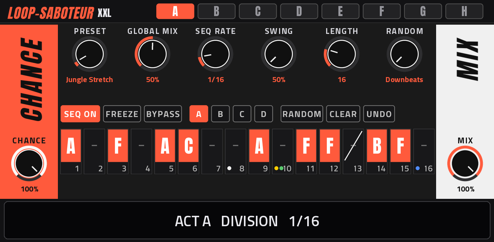
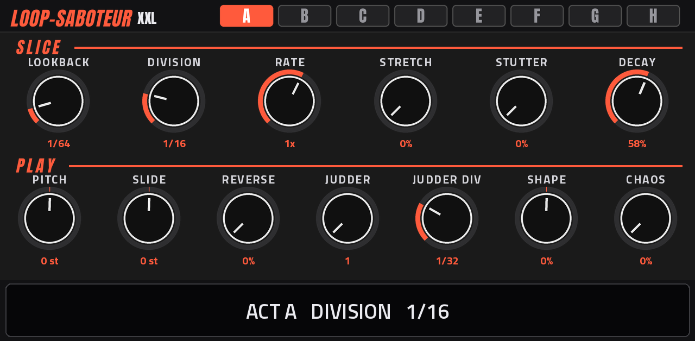
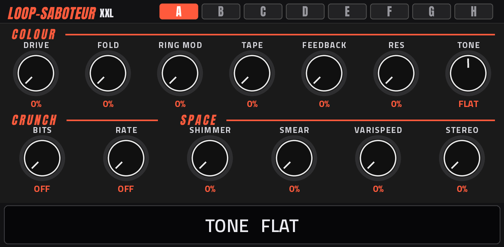
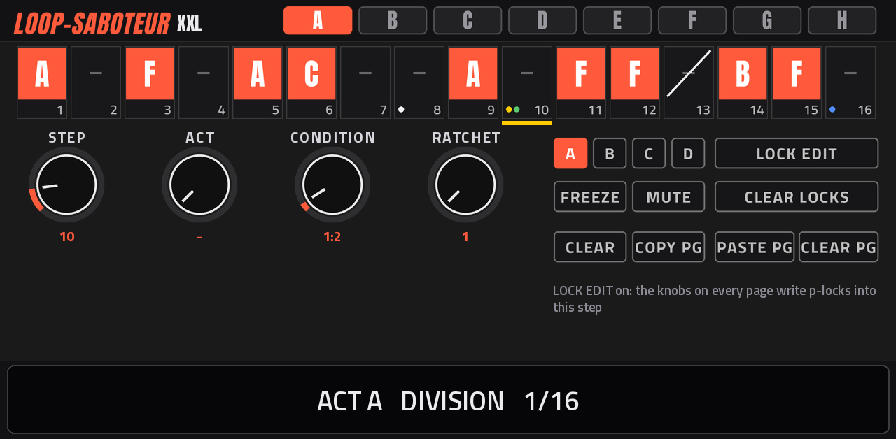
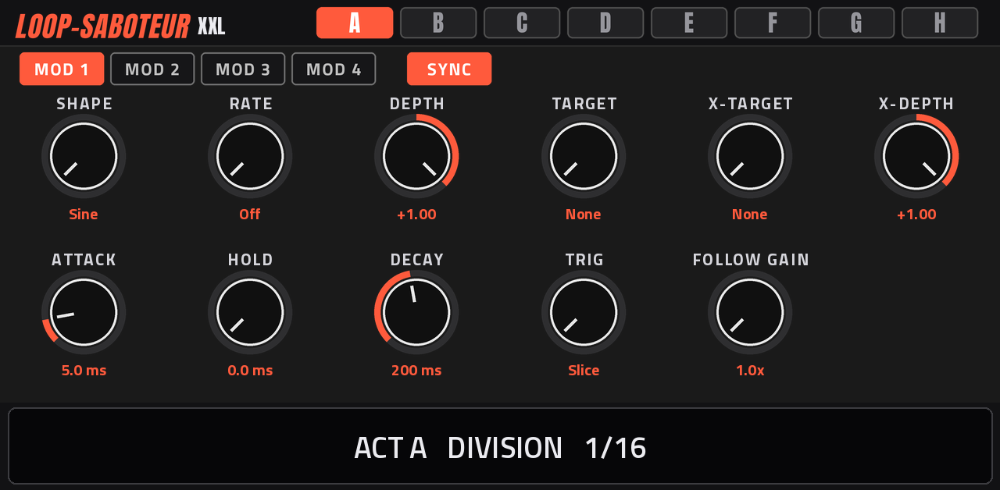
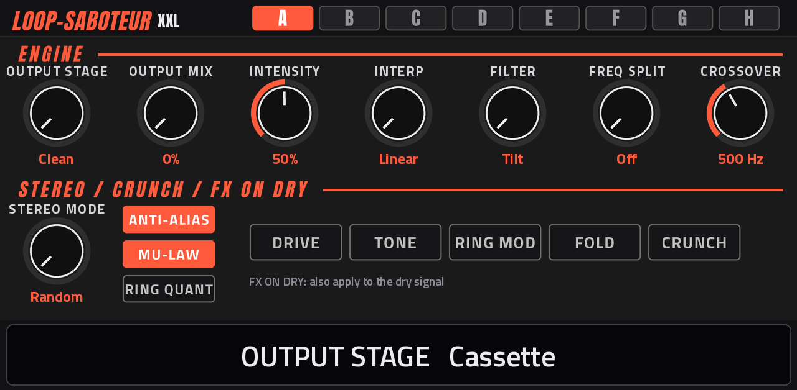
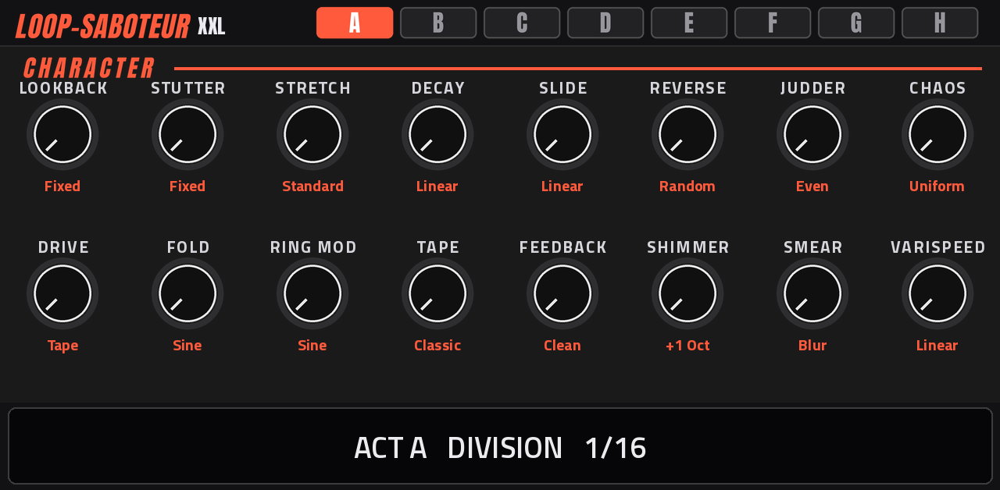
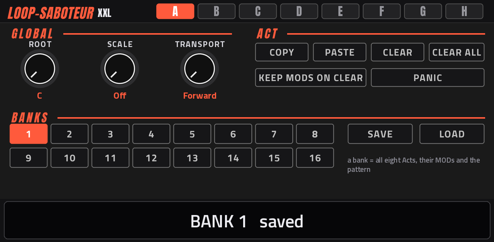

# Loop-SaboteurXXL — USE ME

**Version 0.1.1 · for MPC OS on the Akai Force (first-generation MPC OS units should work too)**

Loop-SaboteurXXL is **Loop Saboteur** by Stephen McLeod Blythe / AMFAS
([clickysteve/Loop-Saboteur](https://github.com/clickysteve/Loop-Saboteur)) running as a native insert effect inside
MPC OS. The sound engine is the original's own code. This port gives it MPC screens, Q-Links, saving with your project
and banks on the device. Art and build: Claude. Developer: L'Cronx.

This guide takes you from the zip file to playing it: installing, the screens, the sequencer, the MODs, saving, the
Q-Links, recipes and fixes. For the deeper story of each effect, Loop Saboteur's own manual is at
[clickysteve.github.io/Loop-Saboteur](https://clickysteve.github.io/Loop-Saboteur/).

**Contents**

1. [What it does, in one minute](#1-what-it-does-in-one-minute)
2. [Install](#2-install)
3. [Put it on a track](#3-put-it-on-a-track)
4. [Your first minute with it](#4-your-first-minute-with-it)
5. [The screen: header, pages, readout](#5-the-screen-header-pages-readout)
6. [The pages, control by control](#6-the-pages-control-by-control)
7. [The sequencer in depth](#7-the-sequencer-in-depth)
8. [MODs in depth](#8-mods-in-depth)
9. [Saving: projects and banks](#9-saving-projects-and-banks)
10. [Q-Links and MIDI](#10-q-links-and-midi)
11. [Recipes](#11-recipes)
12. [Troubleshooting](#12-troubleshooting)
13. [Update and uninstall](#13-update-and-uninstall)
14. [Differences from the desktop plugin](#14-differences-from-the-desktop-plugin)
15. [Credits and licence](#15-credits-and-licence)

---

## 1. What it does, in one minute

Loop-SaboteurXXL **records the last bars** of whatever goes through it into a rolling buffer (32 seconds of stereo).
On the beats of **MPC's song grid** it **fires**: it grabs a **slice** of that buffer and plays it back through a
chain of effects, mixed over your untouched (dry) signal:

```
 your audio ─┬──────────────────── dry ─────────────────────┬─► MIX ─► OUTPUT STAGE ─► out
             │                                              │
             └─► buffer ─► SLICE ─► PLAY ─► COLOUR/CRUNCH ─► SPACE
                   ▲                                       │
                   └──── FEEDBACK (the slice back in) ◄────┘

 SLICE: lookback, division, rate, stretch, stutter     PLAY: pitch, slide, reverse, judder, shape
 COLOUR/CRUNCH: drive, fold, ring, tape, filter, bits  SPACE: shimmer, smear, varispeed, stereo
```

- **It only chops while MPC is playing.** The grid is MPC's song position. When you stop, your audio passes dry.
- An **Act** is one complete sound: every knob, four MODs (LFOs or envelopes), the ENGINE settings and the CHARACTER
  modes. There are eight, **A to H**. The knobs always show and edit **the selected Act**.
- **SEQ off (freehand):** the selected Act fires on every **Division** beat, if its **Chance** says so.
- **SEQ on:** a sequencer of up to 64 steps decides **which Act** fires on each step. Empty steps stay dry.

---

## 2. Install

You need:

- An **Akai Force** (or another first-generation MPC OS unit: MPC Live / Live II, One, X, Key 61, untested).
- **MPC OS 3.x**.
- **Root SSH access** to the device (for example through MockbaMod). Stock MPC OS can't install third-party
  plugins.
- A computer on the same network, with `scp` and `ssh` (built into macOS, Linux and Windows 10/11).

Steps:

1. **Save your MPC project.** The installer stops and restarts MPC.
2. Download `Loop-SaboteurXXL-0.1.1-mpc-armv7.zip` from the
   [release page](https://github.com/sunskiefer/Loop-SaboteurXXL/releases/latest) and unzip it. You get a folder
   `Loop-SaboteurXXL-0.1.1`.
3. Find the device's IP address (your router's list, or your mod's network page). Below it's `<device-ip>`.
4. Copy the folder to the device and run the installer:

   ```
   scp -r Loop-SaboteurXXL-0.1.1 root@<device-ip>:/tmp/
   ssh -t root@<device-ip> sh /tmp/Loop-SaboteurXXL-0.1.1/install.sh
   ```

5. Answer **y** when it asks. It checks the device, stops MPC, copies the plugin to
   `/sdcard/Synths/ANDREALPHEUS - VST - Loop-SaboteurXXL/`, backs up `MPC.settings`, adds the plugin to MPC's plugin
   list and starts MPC again. (`-y` after `install.sh` skips the question.)

The zip's own `INSTALL.md` also explains how to install by hand.

---

## 3. Put it on a track

1. Open the insert effects of the track you want to wreck: an audio track with a loop, a drum track, a submix, or
   the master.
2. Add a plugin and choose **Loop-SaboteurXXL** (manufacturer **ANDREALPHEUS**).
3. Open it: its screen fills MPC's plugin view, and the **Q-Links follow the page** you're on.

**Where to put it:**

- **On a drum loop or drum track:** the classic. Slices, stutters and rolls in time.
- **On a pad or melodic part:** use STRETCH, SHIMMER, SMEAR and longer divisions for textures.
- **On a submix or the master:** whole-mix breakdowns and fills. Keep MIX and GLOBAL MIX moderate.

Several instances can run at once, each with its own Acts and pattern.

---

## 4. Your first minute with it

1. **Press play** on a project with a loop on that track.
2. You hear the loop with slices layered in: Act A fires every 1/16 at 100% chance, 50% mix.
3. Go to **ACTS SEQ** and turn **PRESET**: try *Jungle Stretch*, *Snare Roll*, *Whip It*, *Pad Stabber*. Each one
   loads into the selected Act.
4. Tap **B** in the header, pick another preset for Act B.
5. Tap **SEQ ON**. Tap **A** in the header, then tap a few steps; tap **B**, tap a few others. Now the pattern
   switches between the two Acts.
6. On **COLOUR SPACE**, turn DRIVE, BITS or SMEAR. The readout at the bottom tells you what each move did.

That's the loop: build Acts, stamp them on steps, then shape the steps.

---

## 5. The screen: header, pages, readout



**The header** (top of every page):

- The **LOOP-SABOTEUR XXL** logo.
- **A B C D E F G H**: the Act the knobs edit. The selected Act is orange. Switching Acts loads its values into every
  knob on every page.

**The pages** (MPC's page tabs for the plugin):

| Page | What |
| --- | --- |
| **SLICE PLAY** | How the slice is taken and played: Lookback, Division, Rate, Stretch, Stutter, Decay, Pitch, Slide, Reverse, Judder, Judder Div, Shape, Chaos |
| **COLOUR SPACE** | Tone and destruction: Drive, Fold, Ring Mod, Tape, Feedback, Res, Tone, Bits, Rate, Shimmer, Smear, Varispeed, Stereo |
| **ACTS SEQ** | Chance and Mix, presets, the sequencer's settings, the 16-step grid |
| **STEP** | One step's details: Act, condition, ratchet, freeze, mute, p-locks; page copy / paste |
| **MOD** | The selected Act's four MODs |
| **ENGINE** | The selected Act's output stage, interpolation, filter mode, frequency split, stereo mode, crunch options, FX on dry |
| **CHARACTER** | The selected Act's sixteen effect modes (the original's right-click menus) |
| **GLOBAL** | Scale, sequencer direction, Act copy / paste / clear, Panic, banks |

**The readout** (the tall black box at the bottom of every page) says **in words** what the last control did, with
its context:

- `ACT B   DRIVE   35%`: a knob of Act B.
- `STEP 10 LOCK   PITCH   +7 st`: a p-lock on step 10 (LOCK EDIT on).
- `ACT A  MOD 1   RATE   1 bar  (sync)`: a MOD setting.
- `ACT A   OUTPUT STAGE   Cassette  -  C90 wow + flutter + hiss`: modes come with the original's description.
- `BANK 3   saved`, `PATTERN CLEARED   (UNDO brings it back)`: what an action did.

Every knob also shows its value under it, in orange.

---

## 6. The pages, control by control

### SLICE PLAY



| Control | What it does | Range |
| --- | --- | --- |
| **LOOKBACK** | How far back in the buffer the slice is taken. Short: "what just happened" echoes. Long: whole phrases from bars ago | 1/128 … 4 bars |
| **DIVISION** | The slice length, and the grid the Act fires on | 1/32, 1/16T, 1/16, 1/8T, 1/8, 1/4, 1/2, 1, 2, 4 bars |
| **RATE** | Playback speed of the slice; pitch follows (tracker style) | 1/8x … 4x |
| **STRETCH** | Granular time-stretch: slower without dropping the pitch | 0-100% |
| **STUTTER** | A tiny window of the slice looped: buffer-freeze glitch | 0-100% |
| **DECAY** | Level of each judder repeat against the one before (100% = no decay) | 0-100% |
| **PITCH** | Semitones (snapped to the scale on GLOBAL when a scale is set) | -24 … +24 |
| **SLIDE** | Pitch bend applied to each judder repeat | -12 … +12 st |
| **REVERSE** | Chance a slice plays backwards | 0-100% |
| **JUDDER** | Retriggers inside one slice | 1-32 |
| **JUDDER DIV** | Spacing of the retriggers | 1/128 … 1/2 |
| **SHAPE** | Left: soft (low-pass gate decay). Right: snappy transient. Centre: off | -100 … +100% |
| **CHAOS** | Random per-slice glitches: holds, drops, flips, jumps | 0-100% |

### COLOUR SPACE



| Control | What it does |
| --- | --- |
| **DRIVE** | Saturation before the filter (type on CHARACTER: Tape, Tube, Diode, Fuzz) |
| **FOLD** | Wavefolder: metallic harmonics (shape on CHARACTER) |
| **RING MOD** | Ring modulator, 20 Hz to 2 kHz (wave on CHARACTER; scale snap on ENGINE) |
| **TAPE** | Wow and flutter (mode on CHARACTER) |
| **FEEDBACK** | The slice fed back into the buffer, up to 95%: the next slice grabs processed audio |
| **RES** | Filter resonance |
| **TONE** | Filter. In Tilt mode: DARK / FLAT / BRIGHT. In LP / HP / BP mode: the cutoff (mode on ENGINE) |
| **BITS** (CRUNCH) | Bit depth: OFF, then 16-bit down to 2-bit |
| **RATE** (CRUNCH) | Sample-rate reduction, shown as the resulting rate (22.1k … 2.0k) |
| **SHIMMER** | Octave-up halo (interval on CHARACTER) |
| **SMEAR** | Short delay blur at slice edges (character on CHARACTER) |
| **VARISPEED** | A DJ brake on each slice (curve on CHARACTER) |
| **STEREO** | Per-slice stereo width (mode on ENGINE) |

### ACTS SEQ

| Control | What it does |
| --- | --- |
| **CHANCE** (orange strip) | The selected Act's chance to fire on each beat (freehand, and on steps without a condition) |
| **MIX** (white strip) | The selected Act's wet level over the dry |
| **PRESET** | Loads a factory preset into the selected Act, with its MODs, ENGINE and CHARACTER. Shows `-` once you edit the Act |
| **GLOBAL MIX** | Scales every Act's mix: one performance fader for the whole plugin |
| **SEQ RATE** | How fast the sequencer steps: 1/32, 1/16, 1/16T, 1/8, 1/8T, 1/4, 1/4T, 1/2, 1 bar |
| **SWING** | 50% straight, about 54% loose, 66% shuffle, 75% dotted |
| **LENGTH** | Pattern length, 2-64 steps |
| **RANDOM** | What the RANDOM button does (see [7](#7-the-sequencer-in-depth)) |
| **SEQ ON** | Sequencer on / off (off = freehand) |
| **FREEZE** | The buffer stops recording: slices chop what's already in it |
| **BYPASS** | No effect. The buffer keeps recording, so un-bypassing chops at once |
| **A B C D** | Which 16 of the 64 steps the grid shows |
| **RANDOM** (button) | Runs the RANDOM choice |
| **CLEAR** | Empties the pattern |
| **UNDO** | Brings back the pattern from before the last CLEAR, RANDOM, step clear or page paste / clear |
| **The 16 steps** | Tap: put the selected Act on the step. Tap again (same Act): clear it |

**Reading a step:** the Act's letter on orange; a dash when empty; a white slash when muted; dimmed when it's past
the pattern's LENGTH. The dots under it: **yellow** p-locks, **blue** freeze, **green** condition, **white** ratchet.

### STEP



Everything the desktop plugin does with right-click, shift-click, ctrl-click and alt-click on a step:

| Control | What it does |
| --- | --- |
| **Tap a step** / **STEP** | Select the step (yellow frame and bar). STEP reaches all 64 |
| **A B C D** | Flip the page |
| **ACT** | The Act on the selected step (`-` = none) |
| **CONDITION** | When the step fires (table in [7](#7-the-sequencer-in-depth)) |
| **RATCHET** | 1, 2, 3, 4, 6 or 8 hits inside the step |
| **FREEZE** | The buffer holds still while this step plays |
| **MUTE** | The step cuts the sound |
| **LOCK EDIT** | While on, every knob on every page writes a **p-lock** into the selected step |
| **CLEAR LOCKS** | Removes the selected step's p-locks |
| **CLEAR** | Empties the selected step |
| **COPY PG / PASTE PG / CLEAR PG** | The visible 16 steps, all their settings |

### MOD



| Control | What it does |
| --- | --- |
| **MOD 1-4** | Which of the selected Act's MODs is shown |
| **SYNC** | On: RATE in bar divisions, locked to the song. Off: RATE in Hz, free-running |
| **SHAPE** | Sine, Triangle, Saw, Square, S&H, Env AHD, Env Follow |
| **RATE** | Off, 1/32 … 16 bars (sync) or 0.05 … 30 Hz (free). For Env Follow: the smoothing |
| **DEPTH** | -1 … +1 (negative inverts) |
| **TARGET** | Which knob it moves: None, or any of 29 lockable controls (alphabetical) |
| **X-TARGET / X-DEPTH** | This MOD also scales another MOD's depth |
| **ATTACK / HOLD / DECAY** | The AHD envelope's times, 1 ms to 2 s |
| **TRIG** | What restarts the envelope: Slice, Active Step, Active + Locks, All Steps |
| **FOLLOW GAIN** | Env Follow's input sensitivity, 1x … 10x |

### ENGINE



| Control | What it does |
| --- | --- |
| **OUTPUT STAGE** | A character on the whole output while this Act plays: Clean, Cassette, Reel-to-Reel, Damaged, Vinyl, Boombox, AM Radio, VHS Hi-Fi, Bus Comp, Lathe, Phone Bus |
| **OUTPUT MIX / INTENSITY** | How much of the output stage, and how strongly |
| **INTERP** | How slices are read: Linear, Drop-sample (SP-1200 grit), Cubic (smooth) |
| **FILTER** | TONE and RES as Tilt, LP, HP or BP |
| **FREQ SPLIT / CROSSOVER** | Effects only on the Low or High band (80 Hz … 8 kHz split); the other band stays clean |
| **STEREO MODE** | How STEREO spreads slices: Random, Ping-Pong, Auto-Pan, Haas |
| **ANTI-ALIAS / MU-LAW** | The crunch's character: both on = warm sampler, both off = harsh digital |
| **RING QUANT** | Ring mod frequency snapped to the GLOBAL scale |
| **FX ON DRY** | DRIVE, TONE, RING MOD, FOLD, CRUNCH also on the dry signal |

### CHARACTER



The original's right-click modes, per Act. The readout describes each option as you turn.

| Knob | Options |
| --- | --- |
| LOOKBACK | Fixed, Jittered, Quantised |
| STUTTER | Fixed, Decaying, Growing |
| STRETCH | Standard, Paulstretch, Spectral, Formant |
| DECAY | Linear, Exponential, Logarithmic, Gate |
| SLIDE | Linear, Exponential, Log, S-Curve |
| REVERSE | Random, Alternate, Palindrome, Ping-Pong |
| JUDDER | Even, Accelerating, Decelerating, Random |
| CHAOS | Uniform, Gaussian, Drunk Walk, Bipolar Snap |
| DRIVE | Tape, Tube, Diode, Fuzz |
| FOLD | Sine, Triangle, Asymmetric |
| RING MOD | Sine, Square, Triangle, Saw |
| TAPE | Classic, Wow Only, Flutter Only, Extreme |
| FEEDBACK | Clean, Filtered, Saturated, Ducked |
| SHIMMER | +1 Oct, +2 Oct, -1 Oct, +5th, +5th/Oct |
| SMEAR | Blur, Diffuse, Freeze |
| VARISPEED | Linear, Exponential, Sudden |

### GLOBAL



| Control | What it does |
| --- | --- |
| **ROOT / SCALE** | Snap PITCH to a scale: Off, Chromatic, Major, Minor, Dorian, Phrygian, Mixolydian, Harmonic Min, Whole Tone, Penta Minor, Blues |
| **TRANSPORT** | Sequencer direction: Forward, Reverse, Ping-Pong, Random |
| **COPY / PASTE** | Copy the selected Act, paste onto another (select it first) |
| **CLEAR / CLEAR ALL** | Reset the selected Act / all Acts to the defaults |
| **KEEP MODS ON CLEAR** | When on, clearing an Act keeps its MODs |
| **PANIC** | Stops the sound now (the slice, any ratchet, the smear tail) and empties the buffer. Settings stay |
| **BANKS 1-16, SAVE, LOAD** | See [9](#9-saving-projects-and-banks) |

---

## 7. The sequencer in depth

**Steps and pages.** 64 steps, 16 per page (**A B C D**). **LENGTH** sets where the pattern loops, 2 to 64. Steps
past the length are shown dimmed. **SEQ RATE** is one step's length.

**Stamping.** On ACTS SEQ, pick an Act in the header, then tap steps. On STEP, pick a step and turn **ACT**.

**Each Act keeps its own Division.** The sequencer moves at SEQ RATE, but a step fires at its Act's DIVISION. A step
with a 1/32 Act fires twice in a 1/16 step. An Act with a long Division (1 bar) only fires where its grid lands
inside the step.

**Empty steps play dry.** Landing on an empty step stops the slice. If the previous step started a ratchet, the
ratchet plays out.

**Conditions** (STEP → CONDITION):

| Condition | The step fires… |
| --- | --- |
| `--` | by the Act's own CHANCE |
| `1:2`, `2:2` | on the 1st / 2nd of every 2 pattern plays |
| `1:3` … `3:3` | on that play of every 3 |
| `1:4` … `4:4`, `1:5` … `5:5` | the same, for 4 and 5 plays |
| `1:6`, `1:7` | on the first of every 6 / 7 plays |
| `PREV` | if the previous step fired |
| `!PREV` | if the previous step didn't fire |
| `ONCE` | the first time after you press play, then never until play again |
| `25%`, `50%`, `75%` | a fresh dice roll every time |

A condition on a **muted** step decides how often the mute happens (`50%` = mutes half the time).

**Ratchets.** 2, 3, 4, 6 or 8 even hits inside the step, all replaying the same slice. **On an empty step** (no
Act), a ratchet repeats the beat that just passed, clean and in time: instant drum rolls.

**Freeze (per step).** While the step plays, the buffer holds still. The steps after it chop the frozen moment.

**P-locks.** Select a step, turn **LOCK EDIT** on, then move any knob on any page: that value belongs to that step
only. The knobs show the step's locked values; the readout says `STEP n LOCK`. Turn LOCK EDIT off to edit the Act
again. A p-locked step fires even without an Act (it uses the selected Act's knobs as the base). Lockable: all the
SLICE PLAY and COLOUR SPACE knobs, CHANCE, MIX and GLOBAL MIX. **CLEAR LOCKS** removes them.

**RANDOM** (choose on ACTS SEQ → RANDOM, then tap the RANDOM button):

| Choice | What it does |
| --- | --- |
| Downbeats, Backbeat (2 & 4), Four on the floor, Offbeats, Syncopated (e&a), Son clave (3-3-2) | Rhythmic placements |
| Sparse (25%), Busy (75%), Saturated (all) | Density scatters |
| Euclid E(3) tresillo, E(5) cinquillo, E(7), E(9), E(11) | Euclidean hits spread over the pattern length |
| Euclid go wild, Pattern go wild | A random pick of the above |
| Values: Subtle / Not Subtle | New knob values for the Acts in use (musical ranges, at most two "destroyer" knobs hot per Act) |
| Randomise EVERYTHING | Every Act re-rolled, a new placement and some conditions |

Patterns stamp the Acts you have used (and the selected one). **UNDO** brings the pattern back (not the knob values:
save a bank first if you like what you have).

---

## 8. MODs in depth

Each Act has four MODs. **Only the playing Act's MODs move the sound**: in freehand the selected Act's, with SEQ on
the Act on the current step's.

- **LFOs** (Sine, Triangle, Saw, Square, S&H): with SYNC on they lock to the song position, so a 1-bar LFO is in
  the same place every bar. With SYNC off they run freely in Hz.
- **Env AHD:** an envelope that restarts on TRIG: every **Slice**, every step with an Act (**Active Step**), those
  plus p-locked steps (**Active + Locks**), or every step (**All Steps**). Set ATTACK, HOLD and DECAY.
- **Env Follow:** follows the input's level; RATE becomes the smoothing, FOLLOW GAIN the sensitivity.
- **TARGET** is added to the knob's value (or its p-lock) when a slice fires: each slice gets the MOD's value at that
  moment. **DEPTH** sets how far (1 = the whole range), negative inverts.
- **X-TARGET / X-DEPTH:** cross-modulation. This MOD scales another MOD's depth, e.g. a 4-bar sine fading a fast
  saw in and out.

A MOD with RATE **Off** or TARGET **None** does nothing.

---

## 9. Saving: projects and banks

**With the project.** Everything (all eight Acts, their MODs, ENGINE and CHARACTER, the pattern with its
conditions, ratchets and p-locks, every setting) saves inside your MPC project and comes back when you load it. Save
the project as usual.

**Banks.** 16 slots on the device, for moving a whole setup between projects:

1. GLOBAL → tap a slot **1-16**. The readout says `BANK n   empty` or `BANK n   saved (LOAD to recall)`.
2. **SAVE** writes all eight Acts, their MODs, the pattern and the knob settings into that slot.
3. **LOAD** replaces your current setup with the slot's. Save first if you want to keep what you have.

Banks are files on the device: `/sdcard/Loop-SaboteurXXL Banks/Bank 01.lsxxl` … `Bank 16.lsxxl`. They are plain text.
Copy them off or share them with `scp`:

```
scp "root@<device-ip>:/sdcard/Loop-SaboteurXXL Banks/Bank 01.lsxxl" .
```

That folder is outside the plugin's folder, so updates and uninstalls don't touch it.

---

## 10. Q-Links and MIDI

Every page's controls are on the Q-Links, in reading order (top left first): **1-8 are the first bank, 9-16 the
second**. The Act select is the last Q-Link where it fits. The step cells aren't on Q-Links (STEP and the page
buttons reach every step).

| Page | Q-Links 1-8 | Q-Links 9-16 |
| --- | --- | --- |
| SLICE PLAY | 1 LOOKBACK · 2 DIVISION · 3 RATE · 4 STRETCH · 5 STUTTER · 6 DECAY · 7 PITCH · 8 SLIDE | 9 REVERSE · 10 JUDDER · 11 JUDDER DIV · 12 SHAPE · 13 CHAOS · 14 ACT |
| COLOUR SPACE | 1 DRIVE · 2 FOLD · 3 RING MOD · 4 TAPE · 5 FEEDBACK · 6 RES · 7 TONE · 8 BITS | 9 RATE · 10 SHIMMER · 11 SMEAR · 12 VARISPEED · 13 STEREO · 14 ACT |
| ACTS SEQ | 1 PRESET · 2 GLOBAL MIX · 3 SEQ RATE · 4 SWING · 5 LENGTH · 6 RANDOM · 7 SEQ ON · 8 FREEZE | 9 BYPASS · 10 PAGE · 11 RANDOM (button) · 12 CLEAR · 13 UNDO · 14 CHANCE · 15 MIX · 16 ACT |
| STEP | 1 PAGE · 2 LOCK EDIT · 3 STEP · 4 ACT · 5 CONDITION · 6 RATCHET · 7 FREEZE · 8 MUTE | 9 CLEAR LOCKS · 10 CLEAR · 11 COPY PG · 12 PASTE PG · 13 CLEAR PG · 14 ACT (header) |
| MOD | 1 MOD · 2 SYNC · 3 SHAPE · 4 RATE · 5 DEPTH · 6 TARGET · 7 X-TARGET · 8 X-DEPTH | 9 ATTACK · 10 HOLD · 11 DECAY · 12 TRIG · 13 FOLLOW GAIN · 14 ACT |
| ENGINE | 1 OUTPUT STAGE · 2 OUTPUT MIX · 3 INTENSITY · 4 INTERP · 5 FILTER · 6 FREQ SPLIT · 7 CROSSOVER · 8 ANTI-ALIAS | 9 STEREO MODE · 10 DRIVE ON DRY · 11 TONE ON DRY · 12 RING MOD ON DRY · 13 FOLD ON DRY · 14 CRUNCH ON DRY · 15 MU-LAW · 16 RING QUANT |
| CHARACTER | 1 LOOKBACK · 2 STUTTER · 3 STRETCH · 4 DECAY · 5 SLIDE · 6 REVERSE · 7 JUDDER · 8 CHAOS | 9 DRIVE · 10 FOLD · 11 RING MOD · 12 TAPE · 13 FEEDBACK · 14 SHIMMER · 15 SMEAR · 16 VARISPEED |
| GLOBAL | 1 COPY · 2 PASTE · 3 CLEAR · 4 CLEAR ALL · 5 ROOT · 6 SCALE · 7 TRANSPORT · 8 KEEP MODS | 9 PANIC · 10 BANK · 11 SAVE · 12 LOAD · 13 ACT |

**How a Q-Link acts:**

| Control | A Q-Link turn |
| --- | --- |
| Knob | Turns it |
| Option list (Division, Preset, Condition, Act…) | One option per three Q-Link clicks (the data wheel too), at most five options a second, so a fast turn doesn't skip |
| On / off (SEQ ON, FREEZE, LOCK EDIT…) | Right = on, left = off |
| Action button (RANDOM, CLEAR, UNDO, PANIC, SAVE, LOAD, COPY…) | Fires once per turn to the right (a turn to the left does nothing); a tap on the screen fires it too |

**MIDI.** On the track's MIDI input, **CC 20-35** move the SLICE PLAY page's Q-Links 1-16 (CC 20 = LOOKBACK, CC 21 =
DIVISION, …), and **NRPN n** sets parameter n. Those CCs are used by the plugin only. Option lists follow a CC at
most five steps a second, like a Q-Link.

---

## 11. Recipes

**Instant glitch fill on the master (freehand).**
On Act A: DIVISION 1/16, LOOKBACK 1/16, JUDDER 4, JUDDER DIV 1/64, DECAY 85%, MIX 60%. Keep **GLOBAL MIX** on a
Q-Link (ACTS SEQ, Q-Link 2): at 0% it's dry, push it up into the last bar for a fill.

**Two-Act groove.**
Act A: a light chop (DIVISION 1/16, MIX 40%). Act B: a pitched stutter (JUDDER 4, JUDDER DIV 1/64, SLIDE +2,
DECAY 85%, REVERSE 30%; four 1/64 repeats fill one 1/16 step, since the next empty step cuts the slice). SEQ ON, LENGTH 16: stamp A on 1, 5, 9, 13 and B on 7, 15. On step 15, CONDITION 1:2 so B only
plays every other bar.

**Drum rolls without an Act.**
SEQ ON. On STEP, select step 16 and set ACT `-`, RATCHET **8**. Every bar ends with a clean roll of the beat that just
passed. Use RATCHET 3 on step 12 for a triplet stumble.

**A melodic pitch run with p-locks.**
Stamp Act A on steps 13-16. Select 13, LOCK EDIT on, set PITCH +3. Step 14: +5. Step 15: +7. Step 16: +12. LOCK EDIT
off. (Set GLOBAL → SCALE to keep the Act's own PITCH in key.)

**Lo-fi sampler.**
ENGINE: INTERP Drop-sample, ANTI-ALIAS off, MU-LAW on, OUTPUT STAGE Vinyl, OUTPUT MIX 60%. COLOUR SPACE: BITS 12-bit,
RATE about 11k, TAPE 20%.

**Moving filter.**
ENGINE: FILTER LP. COLOUR SPACE: TONE 60%, RES 50%. MOD 1: SHAPE Sine, SYNC on, RATE 2 bars, TARGET Tone, DEPTH 0.4.
Each slice's cutoff follows a 2-bar sweep.

**Ducking slices with the input.**
MOD 2: SHAPE Env Follow, TARGET Mix, DEPTH -0.8, FOLLOW GAIN 3x. Loud hits get drier slices, quiet parts wetter.

**Freeze and destroy.**
Tap **FREEZE** on a moment you like: the buffer holds it. Now turn LOOKBACK, PITCH and REVERSE: you're playing that
moment. Tap FREEZE again to let new audio in. For a freeze on chosen steps only, use STEP → FREEZE.

**Tape-stop ends.**
Act C: DIVISION 1/2, VARISPEED 100%, CHARACTER → VARISPEED Exponential. In a 16-step 1/16 pattern, stamp C on
steps 9-16: a 1/2 Act fires on the half bar (step 9), and the steps after it keep the brake running. Give step 9
CONDITION 4:4: every fourth bar ends on a brake.

**Performance switching.**
Leave SEQ off and keep **ACT** on a Q-Link (last Q-Link of most pages): turning it switches the whole sound between
your eight Acts, live.

---

## 12. Troubleshooting

| Symptom | Fix |
| --- | --- |
| **Nothing happens** | Press play: it chops on the song grid. With SEQ on, stamp some steps. Check CHANCE, MIX and GLOBAL MIX |
| **Total silence** | The **Cage 4'33"** preset is the original's joke: it silences the whole plugin. Select that Act and move any of its knobs, or load another preset into it |
| **A runaway howl or build-up** | FEEDBACK, SHIMMER and RES high together build up. Tap **PANIC** (GLOBAL) and lower them |
| **Only dry on some steps** | Empty steps play dry. Stamp an Act, or add a ratchet / p-lock |
| **A step never fires** | Check its CONDITION, MUTE, the Act's CHANCE, and that its Act's DIVISION lands inside the step |
| **The knobs change "by themselves"** | LOCK EDIT is on: the knobs show the selected step's p-locks. Turn it off |
| **RANDOM does nothing** | Choose a RANDOM mode first, then fire the RANDOM button (tap it, or turn its Q-Link to the right) |
| **BANK LOAD says empty** | Nothing was saved in that slot. The readout shows a slot's state when you tap it |
| **Crackles** | Too much CPU in a busy project. Try Clean output stages, less STRETCH and SMEAR, or a longer Division, and report it under Issues |
| **It isn't in the plugin list** | Re-run `install.sh`, and check `MPC.settings` was restored if MPC came up with default settings |

Report anything odd at
[github.com/sunskiefer/Loop-SaboteurXXL/issues](https://github.com/sunskiefer/Loop-SaboteurXXL/issues), with what you
did and what the readout said.

---

## 13. Update and uninstall

- **Update:** download the new zip and run its `install.sh` the same way. It upgrades in place. Projects and banks
  stay.
- **Uninstall:**

  ```
  ssh -t root@<device-ip> sh /tmp/Loop-SaboteurXXL-0.1.1/uninstall.sh
  ```

  It stops MPC, removes the plugin folder and its plugin-list entry, and starts MPC again. Projects that used it load
  without it. Your banks folder is kept.

---

## 14. Differences from the desktop plugin

- **The screen:** right-click menus and modifier clicks are on the STEP, ENGINE and CHARACTER pages. The scrolling
  waveform strip and the knobs' cyan MOD rings aren't drawn (animated pictures cost screen CPU on MPC). The readout
  tells you what changed instead.
- **Presets:** the 19 factory presets are there. The user preset files (`.lpsbact`) and the XML Act / bank
  import-export are replaced by the 16 banks.
- **Not ported:** the lookahead output delay (MPC doesn't compensate plugin latency), UI scale, tooltips, grid
  accent, page-follows-playhead, and the momentary freeze mode (FREEZE is a toggle: tap on, tap off).
- **The engine:** unchanged, except that MODs of Acts that aren't playing catch up once per audio block instead of
  every sample. They don't touch the sound until their Act plays, so you hear no difference.

---

## 15. Credits and licence

- **Loop Saboteur** (the effect: its sound engine, effects, Acts, sequencer, MODs, output stages, factory presets,
  randomisers and the design of its interface): **Stephen McLeod Blythe / AMFAS**
  ([clickysteve](https://github.com/clickysteve)), GPL-3.0. All credit for how this sounds goes to him.
- **Art and build:** Claude (Anthropic).
- **Developer:** L'Cronx.
- **VST2 wrapper, skin generator and installer:** sd88me's
  [mpc-vst-plugins](https://github.com/sd88me/mpc-vst-plugins) (MIT).
- **Fonts:** Anton (The Anton Project Authors) and Titillium Web (Accademia di Belle Arti di Urbino), SIL Open Font
  License 1.1.

Loop-SaboteurXXL is free software under the **GNU GPL v3.0 or later**. Source:
[github.com/sunskiefer/Loop-SaboteurXXL](https://github.com/sunskiefer/Loop-SaboteurXXL). It is an unofficial port,
not affiliated with or endorsed by Stephen McLeod Blythe / AMFAS or Akai Professional.
